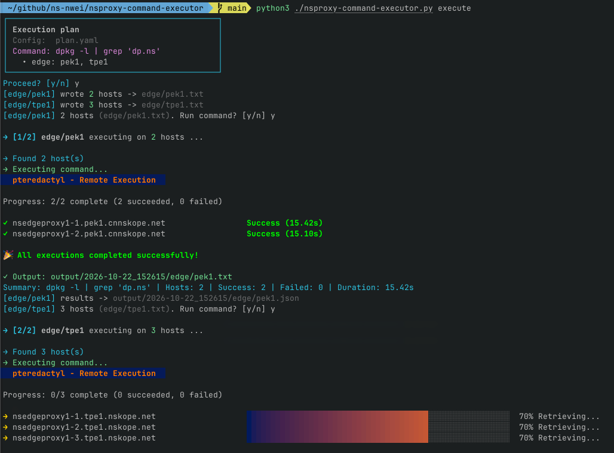
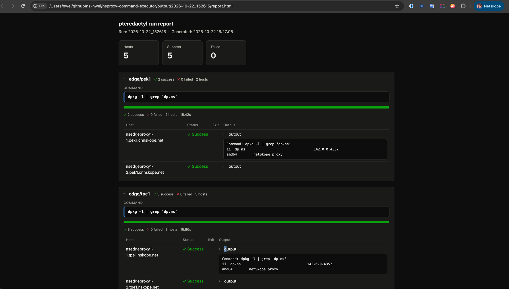

# Purpose

Run a command across many POP hosts (nsproxy / edge) without SSH-ing one by one.

This tool:

1. Discovers hosts per POP via `tsh ls` (with correct proxy/cluster handling, including China POPs)
2. Executes the configured command on each host through [pteREDACTyl](https://github.com/netSkopePlatformEng/pteREDACTyl)
3. Saves per-POP results as JSON and generates an HTML report for review

Dangerous commands (e.g. `rm -rf`) are rejected by a built-in blacklist before
anything is executed.

# Prerequisite

- Python 3 with PyYAML: `pip install -r requirements.txt`
- Install [ntsh](https://github.com/netSkopePlatformEng/ntsh)
- Install [pteREDACTyl](https://github.com/netSkopePlatformEng/pteREDACTyl)
- Register tsh proxy
```sh
ntsh proxy add teleport.netskope.io
ntsh proxy add teleport.cnnetskope.io
ntsh login
```

> China POPs (`pek1`, `pvg1`, `pvg2`, `szx1`) are routed through
> `teleport.cnnetskope.io` (cluster `china-prod`) automatically; make sure both
> proxies are logged in.

# Usage

## Generate host lists only

```sh
./nsproxy-command-executor.py gen-host-list --service nsproxy --pops phx1,tpe1
# writes nsproxy/phx1.txt, nsproxy/tpe1.txt
```

## Execute the plan

```sh
./nsproxy-command-executor.py execute                 # uses plan.yaml
./nsproxy-command-executor.py execute --config prod.yaml
```

Flow: plan confirmation → host list generation → per-POP confirmation →
`pteredactyl exec` (with progress bar) → JSON results → HTML report
(auto-opened in browser).

| Flag | Applies to | Description |
|------|-----------|-------------|
| `--config` | `execute` | Plan file (default: `plan.yaml`) |
| `--out-dir` | both | Base directory for outputs (default: `.`) |
| `--debug` | both | Log external commands (`tsh`, `pteredactyl`) before invocation |
| `--service` | `gen-host-list` | `nsproxy` or `edge` |
| `--pops` | `gen-host-list` | Comma-separated POP names |

## Plan file (`plan.yaml`)

```yaml
services:
  - nsproxy
  # - edge

pops:
  - phx1
  - tpe1

command: "uptime"
concurrency: 4        # pteredactyl max concurrent executions (default: 4)
slient: false         # true = skip all confirmations and run end-to-end

# Extra blacklist regex patterns on top of the built-in dangerous-command list
# blacklist:
#   - "apt\\s+(remove|purge)"
#   - "systemctl\\s+stop"
```

> Legacy keys `service` / `commands` are still accepted, and the `slient`
> spelling is intentional (the conventional `silent` also works).

## Command blacklist

The configured `command` is checked against a built-in blacklist before
anything runs. Blocked commands are rejected outright (no confirmation, no
host touched) — there is no override flag:

- recursive `rm` (`rm -r` / `rm -rf` / `rm --recursive`)
- `mkfs`, `dd ... of=/dev/*`, redirects into block devices
- `shutdown` / `reboot` / `halt` / `poweroff` / `init 0` / `init 6`
- fork bomb
- `find / ... -delete`, `chmod -R 777`
- `curl|wget ... | sh`, `iptables -F` / `ip6tables --flush`

Extend it via the `blacklist` key in `plan.yaml`.

## Output layout

Each run creates a timestamped directory:

```
output/2026-10-22_152615/
├── edge/
│   ├── pek1.json      # per-POP results (parsed from pteredactyl report)
│   └── tpe1.json
└── report.html        # aggregated HTML report
```

# Screenshots

## CLI execution flow

Plan box with confirmation, per-POP progress (`[1/2] edge/pek1 ...`), and
pteredactyl's own progress bar:



## HTML report

Stat tiles, collapsible per-POP cards (command banner, success bar, host
details with output):


